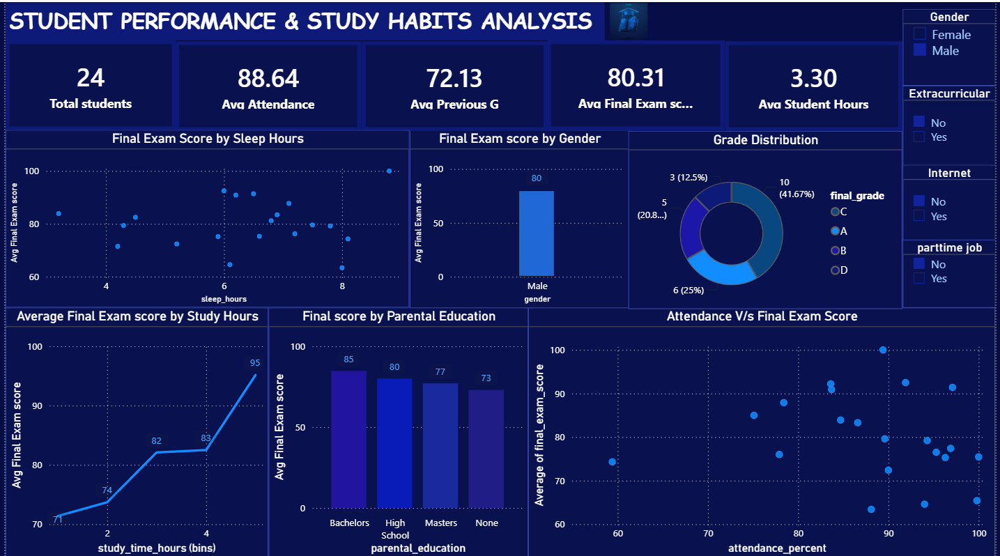

# Student Performance & Study Habits Analysis

A Power BI dashboard that analyses how study hours, sleep, attendance, parental education and other habits affect students' final exam scores. Built on a simulated student dataset, with a PowerPoint presentation explaining the findings.

## Dashboard contents
- **KPI cards** – Total students, Avg Attendance, Avg Previous Grade, Avg Final Exam Score, Avg Study Hours
- **Final Exam Score by Sleep Hours** (scatter)
- **Final Exam Score by Gender** (column)
- **Grade Distribution** (donut)
- **Avg Final Exam Score by Study Hours** (line) – scores rise as study time increases
- **Final Score by Parental Education** (column)
- **Attendance vs Final Exam Score** (scatter)
- **Slicers** – Gender, Extracurricular, Internet, Part-time job

> Note: the screenshot shows the dashboard with slicers applied (e.g. Gender = Male), so the numbers are for the filtered view. Clear the slicers in the `.pbix` to see the full dataset.

## Files
| File | Description |
|---|---|
| `Project_student_performance.pbix` | Power BI dashboard |
| `Student_Performance_Presentation.pptx` | Project presentation slides |
| `images/dashboard.png` | Dashboard screenshot |

## Tools
Power BI Desktop, DAX, PowerPoint

## How to open
Install [Power BI Desktop](https://powerbi.microsoft.com/desktop/) and open `Project_student_performance.pbix`.

## Author
Add your name / LinkedIn here
